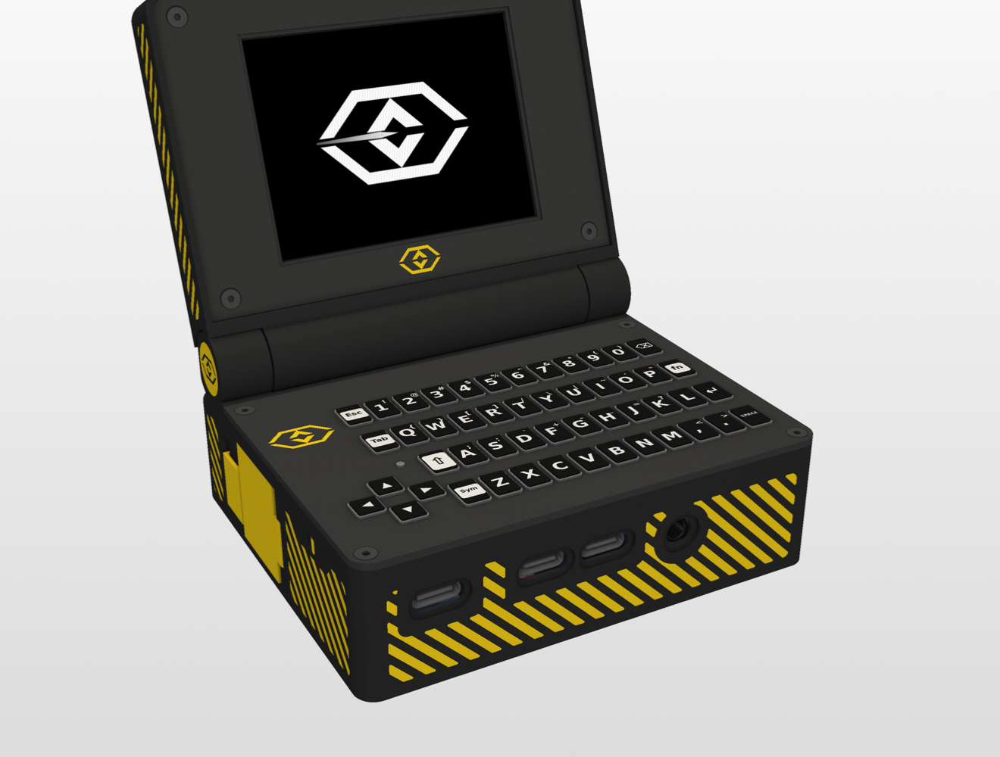

# Minideck build guide

How to build a Minideck from the files in this repo: print, prepare, wire, assemble, first boot.
Every wire and pin is in **[WIRING.md](WIRING.md)**, and the print audit is in [printability_report.md](printability_report.md).

---

## 1. What you need

### Electronics

| Qty | Part | Notes |
|---|---|---|
| 1 | Radxa ZERO 3W | Mounted upside down; wires solder straight to the header pads (no header) |
| 1 | EP28060S 2.8″ IPS panel (non-touch) | In the lid |
| 1 | EHD-40P-V3 HDMI driver board | In the lid. Desolder the touch connector to save height |
| 1 | M5Stack CardKB | Keyboard, I²C |
| 1 | HarukiToreda silicone cover for CardKB | [tindie.com/products/harukitoreda/silicone-cover-for-cardkb](https://www.tindie.com/products/harukitoreda/silicone-cover-for-cardkb/) |
| 1 | PN532 NFC module (Elechouse V3 style) | Set its DIP switches to I²C |
| 1 | PCM5102 I²S DAC (GY-PCM5102) | 3.5 mm jack faces the front |
| 1 | Ebyte E22-900T22S | LoRa, UART |
| 1 | ATGM336H GPS board + 18 × 18 mm ceramic patch | The patch goes in the lid, on 1.13 mm u.FL coax through the hinge |
| 1 | NooElec NESDR Nano 2+ | Its USB plug is cut off; it's wired to header pins 27/28 |
| 3 | FPC antennas: Molex 211140 (LoRa), Molex 146153 (Wi-Fi/BT), one for the SDR | Stuck inside the hinge box |
| 1 | TP4056 USB-C charger (with protection) | |
| 1 | MT3608 boost converter | Set to **5.1 V before** connecting anything |
| 1 | 18650 cell (button top) | |
| 1 | SS12D00 mini slide switch (SPDT) | Power switch: 8.6 × 3.6 × 3.5 mm body; the lever gets trimmed to 1.05 mm. Different size? Edit `SWITCH` in `params.py` |
| 1 | microSD card | For the OS |

### Hardware

| Qty | Part | Where |
|---|---|---|
| 8 | M2 heat-set inserts, 3.5 OD × 3 mm (hole Ø3.2) | 4 in the hinge-box floor (hatch), 4 in the lid shell (bezel) |
| 12 | M2 × 4 countersunk screws | 4 keyboard plate (into printed Ø1.7 pilots), 4 hatch, 4 bezel |
| 1 | Friction torque hinge, cylinder type, body Ø8 × 16, D-shaft Ø5 | Left hinge cheek. Different hinge? Edit `TORQUE` in `base.py` |
| 1 | 1.75 mm filament, ~26 mm | Battery-door hinge pin |
| – | Silicone wire 22/24 AWG (power), 28–30 AWG (signals), heat-shrink, Kapton tape | |

### Tools

Soldering iron (fine tip, plus a heat-set insert tip), flush cutters, tweezers, a multimeter, a 1.27 mm hex key.

---

## 2. Print

Files are in **[`print/`](print/)**, one folder per filament colour (one batch each), already oriented on the bed. PLA, 0.4 mm nozzle.

| File | Colour (palette 1) | Settings |
|---|---|---|
| `bottom.stl` | Charcoal `#2D2D2D` (e.g. Bambu PLA Matte Charcoal) | 0.2 mm layers, supports for the port openings only |
| `screen_back.stl` | Charcoal | 0.2 mm |
| `box_hatch.stl` | Charcoal | 0.2 mm |
| `keyboard_top.stl` | Dark grey `#3D3D3D` (e.g. PLA Basic Dark Gray) | **0.12 mm layers**: the webs between keys are 0.42 mm |
| `screen_front.stl` | Dark grey | 0.12–0.16 mm |
| `battery_door.stl` | Cyber yellow `#F7D116` (e.g. PLA Basic Sunflower Yellow) | **Print upright, with a brim** (0.4 mm skin) |
| `battery_lock_slider.stl` | Cyber yellow | 0.12 mm |
| `hinge_cap.stl`, `hinge_axle.stl` | Cyber yellow | 0.12 mm |

**Optional paint fill.** The logos, MINIDECK text, side stripes and the NFC mark on the underside (under the PN532: board outline, coil, NFC, 13.56 MHz, ISO 14443 A/B, TAP HERE) are engraved 0.3–0.6 mm deep. Go over them with a paint marker (yellow on the dark parts, black on the yellow hinge caps) and wipe the surface with IPA.

---

## 3. Prepare

1. **Heat-set inserts.** Push the 8 inserts in at about 200 °C: 4 into the hinge-box floor and 4 into the lid shell's bezel bosses. Keep them square and flush.
2. **MT3608.** Power it from the bench (or from the TP4056 with a cell) and turn the trimmer until the output reads **5.1 V**.
3. **Radxa: free USB2 HOST2 for the SDR.** Remove **R32** and **R39** (0 Ω; they route I²C4 to pins 27/28) and bridge **R45** and **R46** (marked NC). Pins 27/28 then carry HOST2 D+/D−. See WIRING.md for details.
4. **SDR.** Cut the USB-A plug off the NESDR Nano 2+. Keep VBUS, D−, D+ and GND short; D+/D− stay twisted.
5. **PN532.** DIP switches to **I²C**.
6. **Driver board.** Desolder the touch connector (the tallest part); then the mini-HDMI sets the height.
6. **OS.** Flash Radxa's Debian/Armbian image to the microSD.

---

## 4. Wire

Solder everything **before** it goes into the case: one wire per Radxa pad, laid flat (there's about 3 mm above the board under the keyboard). [WIRING.md](WIRING.md) has the full table; the 3D wire routes are in `out/parts_in_place/wires_*.stl` and show in `viewer.py`.

- **Power:** 18650 → TP4056 B+/B− → TP4056 OUT+ → **power switch** (middle pin in, one outer pin out) → MT3608 → a 5 V / GND splice behind the Radxa → Radxa pins 2/6, the screen (through the hinge) and the GPS (pin 4).
- **I²C5** (pins 29/31): PN532, with the CardKB chained onto the PN532's pins.
- **UART3** (3/5): GPS. **UART4** (16/18): LoRa, plus M0/M1/AUX on 13/7/22.
- **I²S3** (12/35/40): DAC.
- **USB2 HOST2** (27/28) + GND 14: SDR, 5 V from the splice.
- **Through the hollow axle:** the HDMI ribbon, screen 5 V/GND and the GPS patch coax.

Check pin 1 on your board (square pad) before soldering: the plan assumes it's at the microSD end, inner row.

---

## 5. Assemble

The order follows the collision-checked teardown on the promo site, played forwards.

**Base**
1. **PN532** into its floor pocket.
2. **FPC antennas** onto the hinge-box walls: LoRa and SDR on the back wall, Wi-Fi/BT on the top.
3. **LoRa module** and **DAC**, jack into its front hole.
4. **Radxa**, upside down, USB-C ports into the front-wall openings. Its microSD socket is at the board's **left** end (the camera connector is at the right end).
5. **GPS board** in the bay right of the battery; **MT3608** and **TP4056** (USB-C into its front opening).
   **Power switch:** trim the SS12D00's lever to **1.05 mm** above the body with flush cutters. From inside the case, drop the printed knob into the gap between the left wall and the charger, fin toward the wall, and push it sideways into its pocket. The fin pokes out through the small slot, flush with the outside, and the knob can't fall out of the case. Then lower the switch straight down onto its block: its lever slides down the groove in the wall into the knob's open-topped socket. A dab of hot glue holds the switch; wires go to its pins over the charger.
6. **SDR** into the hinge box; route its antenna coax.

**Lid**
7. **GPS patch** into its pocket in the lid shell, coax out through the hinge.
8. **Driver board**, then the **panel**, FPC to the driver.
9. **Bezel** on, 4 × M2 × 4 into the lid inserts.

**Hinge**
10. **Torque hinge** body into the left cheek pocket, D-shaft into the lid barrel.
11. Feed the HDMI ribbon, screen power and GPS coax through the **hollow axle**, then slide the axle in from the right until the flange sits flush.
12. **Hinge cap** over the torque hinge on the left.

**Keyboard**
13. **CardKB** in, its Grove wires out through the groove to the PN532.
14. **Keyboard plate** on, 4 × M2 × 4 into the pilots. Don't overtighten: they're printed threads.
15. **Silicone cover** over the keys.

**Battery and finishing**
16. **Door:** line up the knuckles and drop the 1.75 mm filament pin in from the top of the wall.
17. **C-clip lock** onto its rail; it slides up to unlock and down to lock.
18. **18650** in, button (+) first, then close the door and slide the lock down.
19. **Hatch** on the hinge-box floor, 4 × M2 × 4.
20. **microSD:** there's no outside slot. The socket is at the Radxa's left end, under the keyboard. Flash the card and put it in before step 13, or later take the keyboard plate (4 screws) and keyboard off to swap it.
---

## 6. First boot

1. Charge over the TP4056's USB-C.
2. Boot, then enable the interfaces with `rsetup` (Overlays): **I2C5**, **UART3**, **UART4**, **I2S3** (PCM5102 as a simple-audio-card), and **USB2 HOST2** (EHCI/OHCI) for the SDR.
3. Quick checks:
   - `i2cdetect -y 5` shows the CardKB at `0x5f` and the PN532 at `0x24`.
   - `cat /dev/ttyS3` shows NMEA from the GPS.
   - `rtl_test` finds the RTL2832U.
   - `aplay -l` lists the PCM5102.

---

## Component models

`models/components/` holds the downloaded reference models (sources and licences below), and `models/coloured/` holds the real-colour web versions made from them by `components_web.py` / `coloured_radxa.py`.

| Part | Source | Licence |
|---|---|---|
| Radxa ZERO 3W | dl.radxa.com (official STEP) | Radxa docs: CC BY 4.0 |
| E22-900T22S | cdebyte.com (official STEP) | none stated |
| PN532 V4 | elechouse.com (official STEP) | none stated |
| DSGP184B patch | taoglas.com (official STEP) | none stated |
| M2 heat-set insert | CNC Kitchen, printables.com/model/482734 | CC BY |
| CardKB | printables.com/model/793686 | CC0 |
| MT3608 (reference only) | github.com/WillyCcV19/PI_Equipo_04 | no licence: not used on the site |
| PCM5102 | zynthian-miniature (GPL-3.0), Printables 1765314 (CC0) | not used on the site |
| 2.8″ HDMI LCD | Waveshare (reference), embedded-graphics (MIT) | not used on the site |
