# Minideck

A pocket clamshell cyberdeck. It's fully parametric (Python + [build123d](https://github.com/gumyr/build123d)) and printed on a Bambu printer.


**[Print files →](print/)** · **[Build guide →](BUILD.md)** · [Wiring](WIRING.md) · Promo site: https://zedward856-spec.github.io/minideck-site/ (its own repo: [minideck-site](https://github.com/zedward856-spec/minideck-site))

- **Size:** 93.7 × 81.5 × 39.5 mm (closed).
- **Lid:** opens to 180° on a hidden torque hinge with a hollow axle for the cables.
- **Battery:** one 18650 behind a hinged door, held shut by a C-clip lock.

---

## Colour palettes

Press keys **1–6** in the viewer to switch palettes live. Palette 1 is the one being printed.

| # | Palette | Front | Back |
|---|---|---|---|
| 1 | **Cyber yellow** (print colours) |  | 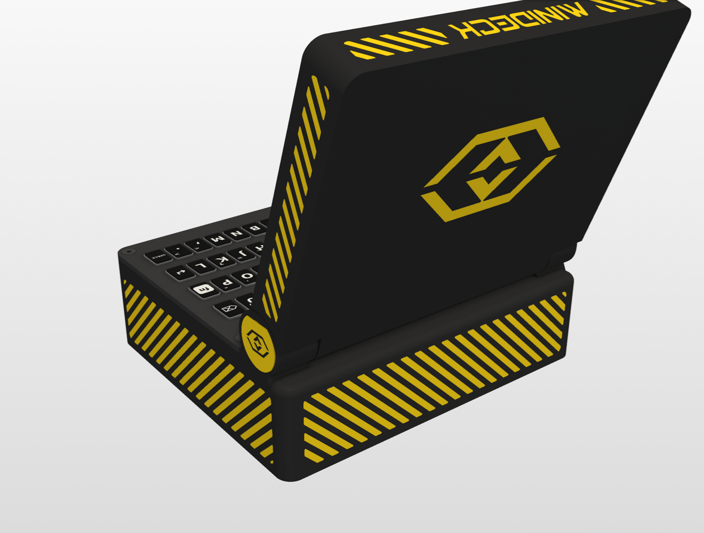 |
| 2 | **Neon night** | 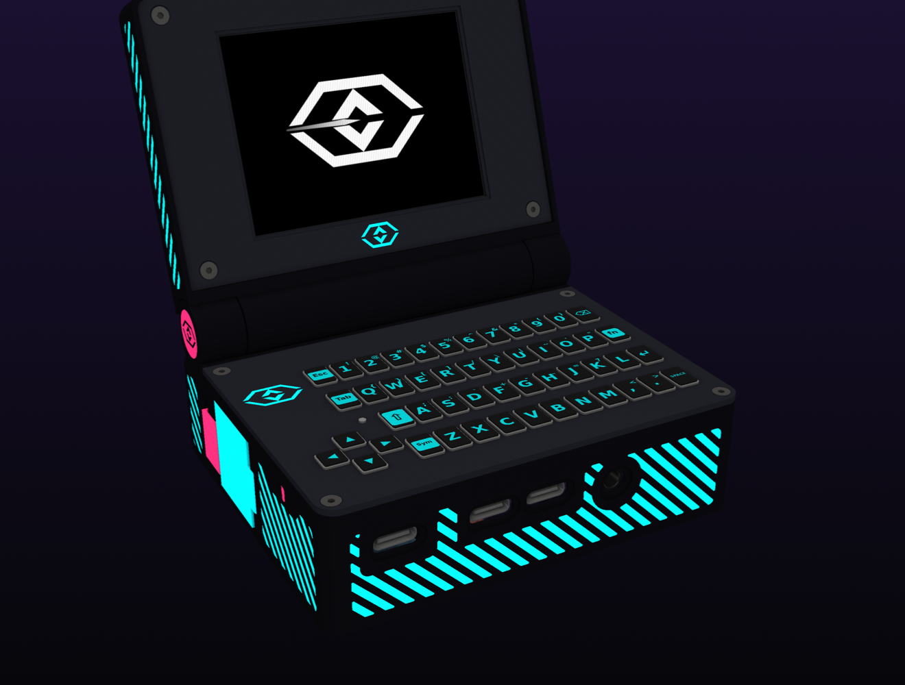 | 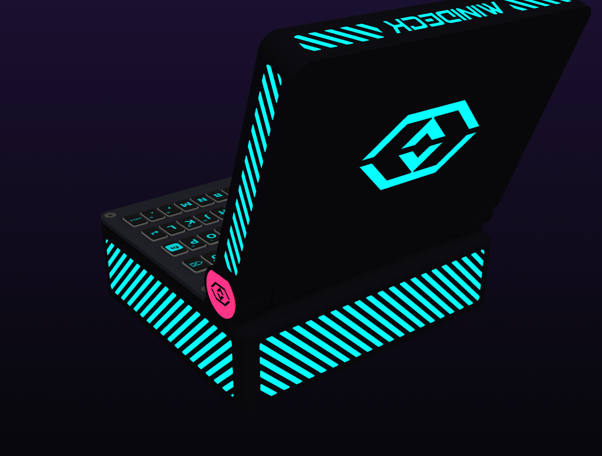 |
| 3 | **Arasaka** | 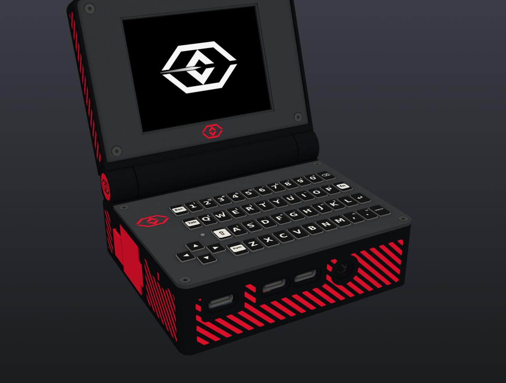 | 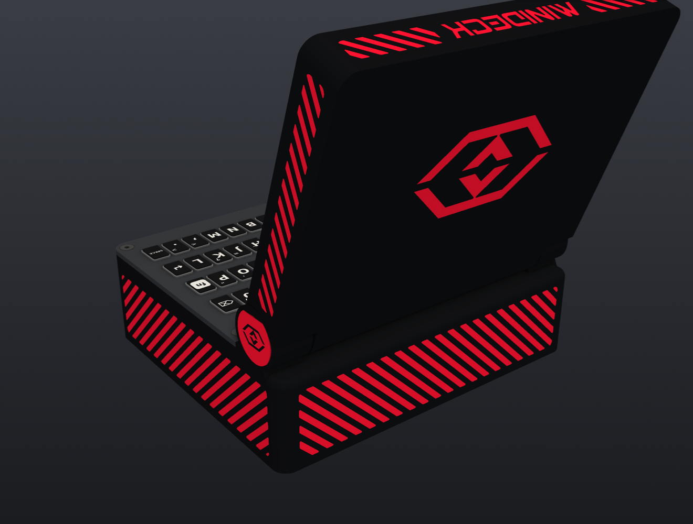 |
| 4 | **Snow** | 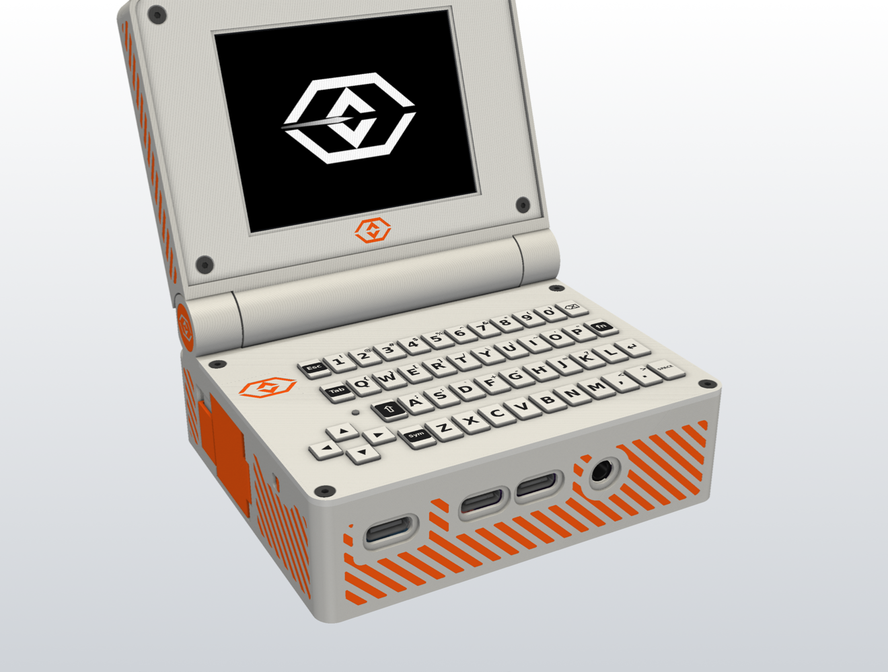 | 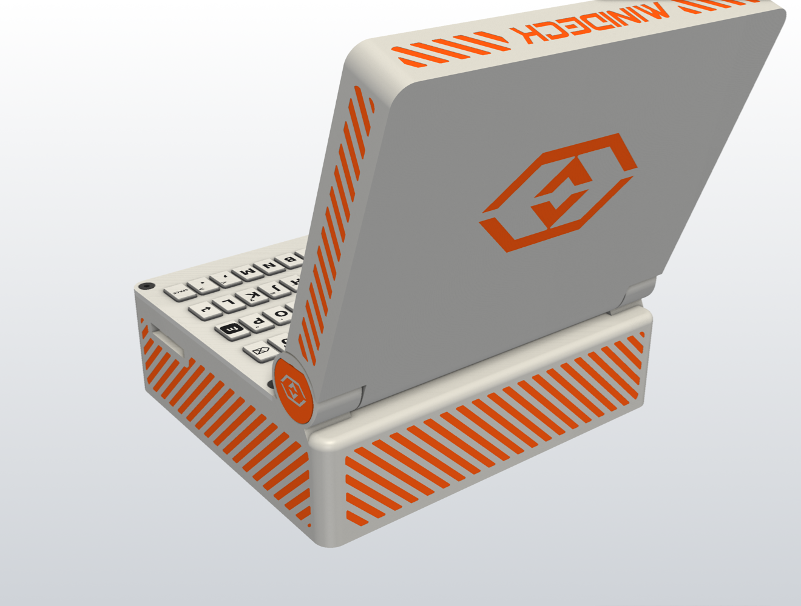 |
| 5 | **Retro beige** | 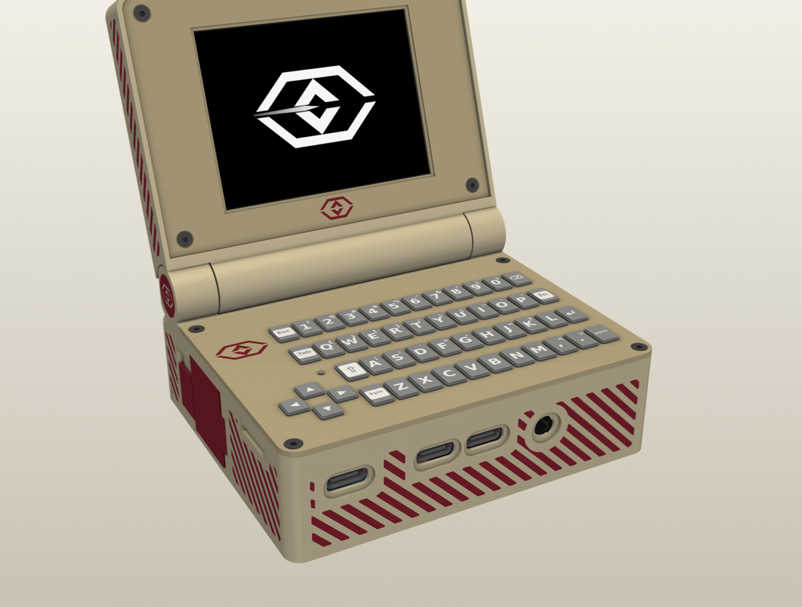 | 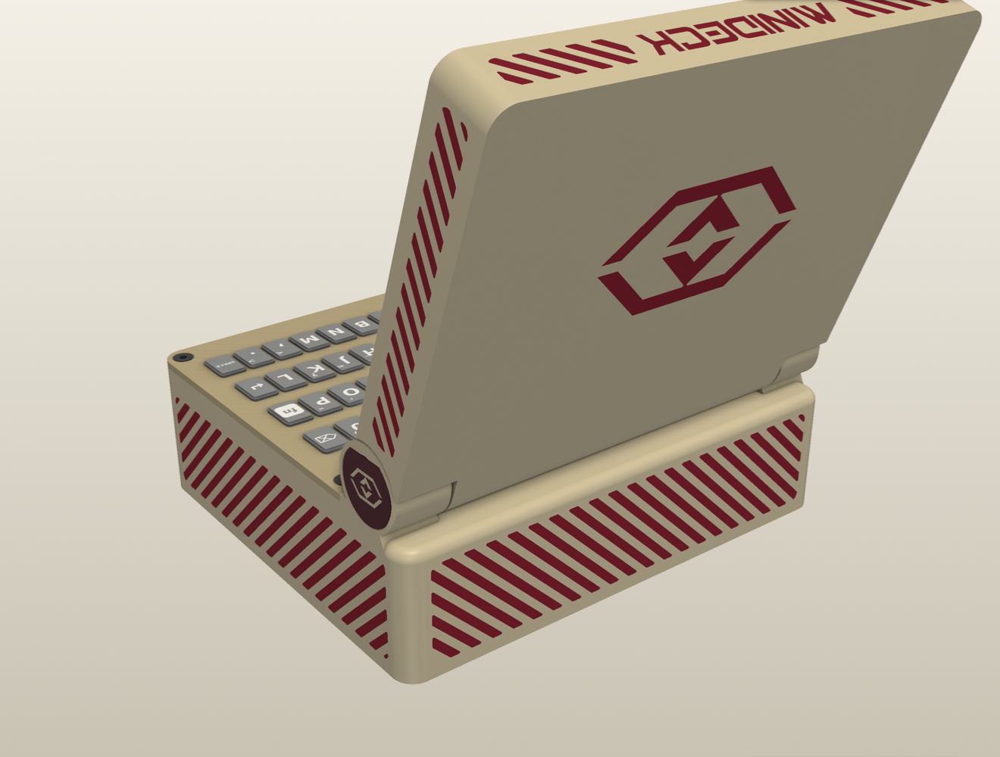 |
| 6 | **Field olive** | 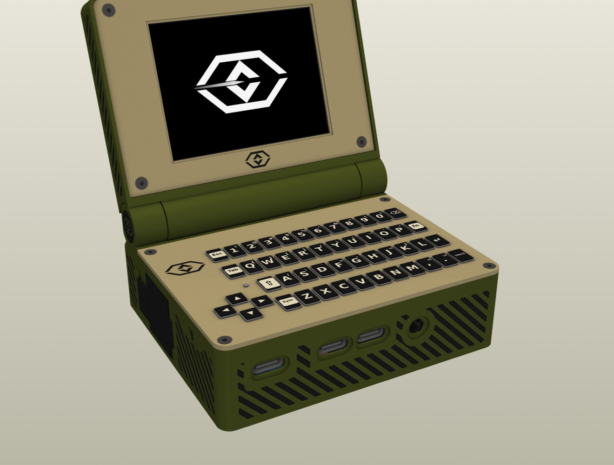 | 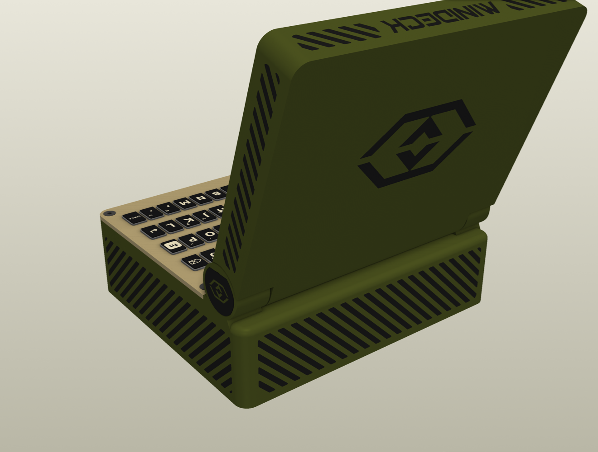 |

| # | Body | Plate / bezel | Accent | Keys / legends |
|---|---|---|---|---|
| 1 | `#2D2D2D` charcoal | `#3D3D3D` dark grey | `#F7D116` cyber yellow | black / white |
| 2 | `#0D0D12` | `#22232C` | `#05D9E8` cyan + `#FF2A6D` magenta | black / cyan |
| 3 | `#111214` | `#3B3D42` | `#E0102A` red | black / white |
| 4 | `#E7E6E1` | `#F6F6F3` | `#FF5A10` orange | white / black |
| 5 | `#D6C9A8` | `#BFB08C` | `#7A1F2B` maroon | grey / white |
| 6 | `#4B5320` olive | `#B8A77C` tan | `#1A1A1A` black | black / cream |

The logos, MINIDECK text and side stripes are engraved 0.3–0.6 mm deep. The renders show them paint-filled: fill them with a paint marker and wipe the surface with IPA. No multi-colour printer needed.

---

## Parts list

### Printed parts

Ready-to-print files are in **[`print/`](print/)**: one folder per filament colour, already in print orientation. Their source files are below, in `out/`.

| File | Part | Colour (palette 1) | Notes |
|---|---|---|---|
| `bottom.stl` | Case bottom: battery chamber, hinge box, ports | Charcoal `#2D2D2D` | Main body; M2 heat-set inserts |
| `keyboard_top.stl` | Keyboard plate | Dark grey `#3D3D3D` | 4 × M2 × 4 screws; 0.12 mm layers recommended (0.42 mm webs) |
| `screen_back.stl` | Lid shell | Charcoal `#2D2D2D` | Lid-back logo, MINIDECK text, stripes |
| `screen_front.stl` | Screen bezel | Dark grey `#3D3D3D` | 4 × M2 screws into lid inserts |
| `box_hatch.stl` | Hinge-box floor hatch | Charcoal `#2D2D2D` | 4 × M2 screws |
| `battery_door.stl` | 18650 battery door | Cyber yellow `#F7D116` | **Print upright, with a brim** |
| `battery_lock_slider.stl` | Battery door C-clip lock | Cyber yellow `#F7D116` | Slides on a rail; no screw |
| `hinge_cap.stl` | Torque hinge end cap | Cyber yellow `#F7D116` | Logo engraved |
| `hinge_axle.stl` | Hollow hinge axle (cable bore) | Cyber yellow `#F7D116` | Logo on the flange |
| `battery_strip_test.stl` | Battery door / lock test strip | any | Optional fit test |

Suggested filament: Bambu PLA Matte Charcoal, PLA Basic Dark Gray and PLA Basic Sunflower Yellow.
`printability_report.md` has the full print audit.

### Electronics

| Part | Role |
|---|---|
| Radxa ZERO 3W | Main computer (mounted upside down, wires soldered to the header pads) |
| EP28060S 2.8″ non-touch IPS panel | Display (in the lid) |
| EHD-40P-V3 HDMI driver board | Display driver (in the lid) |
| M5Stack CardKB + HarukiToreda silicone cover | Keyboard (I²C) |
| PN532 | NFC reader (I²C, chained with the CardKB) |
| PCM5102 I²S DAC | Audio out, 3.5 mm jack |
| Ebyte E22-900T22S | LoRa radio (UART4) |
| GPS module (ATGM336H-class) + 18 × 18 mm ceramic patch | GPS (UART3); patch antenna in the lid |
| NooElec NESDR Nano 2+ | SDR, wired to header pins 27/28 (USB2 HOST2) – no hub |
| Molex 211140 / 146153 FPC antennas | LoRa, Wi-Fi/BT and SDR antennas |
| TP4056 (USB-C) | 18650 charger |
| MT3608 | Boost to 5.1 V |
| 18650 cell | Battery |

### Hardware

| Qty | Part |
|---|---|
| 12 | M2 × 4 countersunk screws (plate 4, hatch 4, bezel 4) |
| 8 | M2 heat-set inserts, Ø3.5 × 3 mm (hole Ø3.2): 4 hatch, 4 bezel (the plate screws go into printed pilots) |
| 1 | Friction torque hinge (pocket in the left hinge cheek) |
| – | Silicone wire: 22/24 AWG for power, 28–30 AWG for signals; 1.13 mm u.FL coax for the antennas |

Every wire, pin and splice is in **[WIRING.md](WIRING.md)**.

---

## Repository layout

| Path | What |
|---|---|
| `params.py` | Every dimension and option (logos, stripes, text, inserts, radios) |
| `layout.py` | Places the parts from the reference layout `models/minideck.stl` |
| `base.py`, `lid.py`, `battery_test.py` | Case bottom, plate, hatch, hinge / lid shell and bezel / battery chamber, door and lock |
| `stripes.py`, `logo.py`, `fills.py` | Hazard stripes, Optic logo engraving, paint-fill preview meshes |
| `wiring.py` | Wiring plan + 3D wire routes (`WIRING.md`) |
| `keycaps.py`, `screws.py` | Viewer-only silicone keycaps and screws |
| `check.py` | 47 fit/clearance requirements |
| `printability.py` | Print audit → `printability_report.md` |
| `viewer.py` | Interactive 3D viewer |
| `print/` | **The print files**, one folder per colour (`python3 export_print.py` rebuilds it) |
| `out/` | Raw CAD output: STLs, STEP assemblies, `parts_in_place/` meshes for the viewer |
| `models/` | Source models, Corpta font, logo SVG, Radxa downloads and schematic; `models/components/` real part models (sources in [BUILD.md](BUILD.md#component-models)), `models/coloured/` their real-colour versions |
| `docs/img/` | README renders |

## Promo site

Live at https://zedward856-spec.github.io/minideck-site/ (repo `minideck-site`). Re-export the web model with `python3 site_export.py && python3 plan_explode.py` (writes into `../minideck-site/assets/`; the second plans the collision-free teardown).

## Build and view

```bash
pip install build123d trimesh manifold3d shapely pyvista pillow
python3 battery_test.py && python3 base.py && python3 lid.py && python3 wiring.py && python3 fills.py && python3 check.py
python3 viewer.py            # 1-6 palettes · g stripe fill · scroll the part list · sliders for lid angle / transparency
```

Re-render the README images (product shots with no UI):

```bash
MINIDECK_CLEAN=1 MINIDECK_PALETTE=1 python3 viewer.py --shot docs/img/palette1_front.png
MINIDECK_CLEAN=1 MINIDECK_PALETTE=1 MINIDECK_CAM="[(190,230,140),(47,42,25),(0,0,1)]" python3 viewer.py --shot docs/img/palette1_back.png
```

---

© zedward. The Corpta font is a demo licence, the Radxa models and schematic are © Radxa, and the logo is the author's own.
